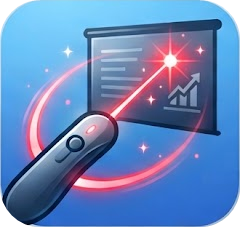
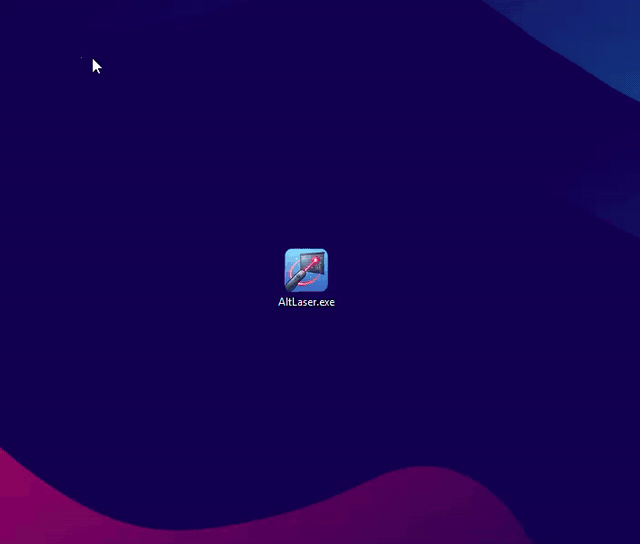

<div align="center">
  
  <h1 align="center">Alt Laser</h1>
  <p align="center">A laser pointer for your whole screen. Hold Alt, point, and it fades away on its own.</p>
  <a href="https://dotnet.microsoft.com/"></a>
  <a href="LICENSE"></a>
  <a href="../../releases/latest"></a>
  <a href="../../releases/latest/download/AltLaser.exe"></a>
  <br><br>
  <b>English</b> · <a href="README.pt-BR.md">Português (Brasil)</a>
</div>

<br>

Made for presentations, classes, and screen sharing on Windows: point at what matters and the
mark clears itself, with nothing to undo.

<p align="center">
  
</p>

## Install

Windows 10 or 11 (64-bit). Nothing else to install.

1. Download [`AltLaser.exe`](../../releases/latest/download/AltLaser.exe) and save it anywhere.
2. Open it. Alt Laser sits in the system tray, ready to use.

The first time, Windows may show a SmartScreen warning ("Windows protected your PC"), because the
app is new and not code-signed yet. Click **Run anyway** (on some versions, click **More info**
first). All the source code is in this repository, and you can build it yourself if you prefer.

## Use

- **Hold left Alt** and move the mouse to draw an arrow. Release it and the arrow fades out.
- **`Alt+L`** turns Alt Laser off and on.
- **Right-click the tray icon** to switch between **Arrow** and **Free draw**, pick a **Color**,
  choose how long strokes stay (**Fade after**) or change the **Language**. Your choices are saved.

Shortcuts like `Alt+Tab` keep working as usual, and the right Alt key (AltGr) is never used.

## Privacy and safety

- Runs only on your computer: no internet connection, no account, no data collected.
- Needs no administrator rights.
- Only reacts to the left Alt key. Nothing you type is recorded or sent anywhere.
- The laser cursor is temporary: your normal cursor comes back when you release Alt or close the app.

<details>
<summary><b>Start with Windows</b></summary>

<br>

Press `Win+R`, type `shell:startup` and press Enter. Put a shortcut to `AltLaser.exe` in the
folder that opens.

</details>

<details>
<summary><b>Uninstall</b></summary>

<br>

Right-click the tray icon → **Exit**, then delete `AltLaser.exe`. To also remove your saved
choices, delete the `%AppData%\AltLaser` folder.

</details>

<details>
<summary><b>Build from source</b></summary>

<br>

Requires the [.NET 10 SDK](https://dotnet.microsoft.com/download).

```powershell
dotnet run --project src/AltLaser
dotnet publish src/AltLaser -p:PublishProfile=SingleExe   # publish/AltLaser.exe
```

The hotkey, sizes and other fine-tuning live in [`LaserSettings.cs`](src/AltLaser/LaserSettings.cs).

</details>

## Credits

Inspired by the laser pointer in [Excalidraw](https://excalidraw.com), a tool I use and recommend.
Alt Laser is an independent project and has no affiliation with Excalidraw.

## License

MIT, see [`LICENSE`](LICENSE).
