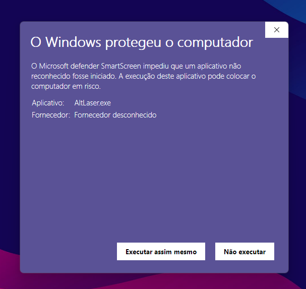
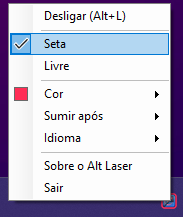

<div align="center">
  
  <h1 align="center">Alt Laser</h1>
  <p align="center">Um ponteiro laser para a tela inteira. Segure o Alt, aponte e ele some sozinho.</p>
  <a href="https://dotnet.microsoft.com/"></a>
  <a href="LICENSE"></a>
  <a href="../../releases/latest"></a>
  <a href="../../releases/latest/download/AltLaser.exe"></a>
  <br><br>
  <a href="README.md">English</a> · <b>Português (Brasil)</b>
</div>

<br>

Feito para apresentações, aulas e compartilhamento de tela no Windows: aponte para o que importa e
a marcação some sozinha, sem nada para desfazer.

<p align="center">
  
</p>

## Instalar

Windows 10 ou 11 (64 bits). Não precisa instalar mais nada.

1. Baixe o [`AltLaser.exe`](../../releases/latest/download/AltLaser.exe) e salve onde quiser.
2. Abra o arquivo. O Alt Laser fica na bandeja do sistema, pronto para usar.

Na primeira vez, o Windows pode mostrar o aviso abaixo do SmartScreen, porque o app é novo e ainda
não tem assinatura digital. Clique em **Executar assim mesmo** (em algumas versões, clique antes em
**Mais informações**). Todo o código-fonte está neste repositório, e você pode compilar o app se
preferir.

<p align="center">
  
</p>

## Usar

- **Segure o Alt esquerdo** e mova o mouse para desenhar uma seta. Ao soltar, a seta some.
- **`Alt+L`** desliga e liga o Alt Laser.
- **Clique com o botão direito no ícone da bandeja** para alternar entre **Seta** e **Livre**,
  escolher a **Cor**, quanto tempo os traços ficam (**Sumir após**) ou trocar o **Idioma**. As
  escolhas ficam salvas.

<p align="center">
  
</p>

Atalhos como `Alt+Tab` continuam funcionando normalmente, e o Alt direito (AltGr) nunca é usado.

## Privacidade e segurança

- Funciona só no seu computador: sem internet, sem conta e sem coleta de dados.
- Não precisa de permissão de administrador.
- Só reage ao Alt esquerdo. Nada do que você digita é gravado ou enviado.
- O cursor de laser é temporário: o cursor normal volta quando você solta o Alt ou fecha o app.

<details>
<summary><b>Iniciar com o Windows</b></summary>

<br>

Aperte `Win+R`, digite `shell:startup` e dê Enter. Coloque um atalho para o `AltLaser.exe` na
pasta que abrir.

</details>

<details>
<summary><b>Desinstalar</b></summary>

<br>

Clique com o botão direito no ícone da bandeja → **Sair** e apague o `AltLaser.exe`. Para remover
também as escolhas salvas, apague a pasta `%AppData%\AltLaser`.

</details>

<details>
<summary><b>Compilar o código-fonte</b></summary>

<br>

Requer o [.NET 10 SDK](https://dotnet.microsoft.com/download).

```powershell
dotnet run --project src/AltLaser
dotnet publish src/AltLaser -p:PublishProfile=SingleExe   # publish/AltLaser.exe
```

O atalho, os tamanhos e outros ajustes finos ficam em [`LaserSettings.cs`](src/AltLaser/LaserSettings.cs).

</details>

## Créditos

Inspirado no laser do [Excalidraw](https://excalidraw.com), uma ferramenta que eu uso e recomendo.
O Alt Laser é um projeto independente e não tem nenhuma ligação com o Excalidraw.

## Licença

MIT, veja [`LICENSE`](LICENSE).
